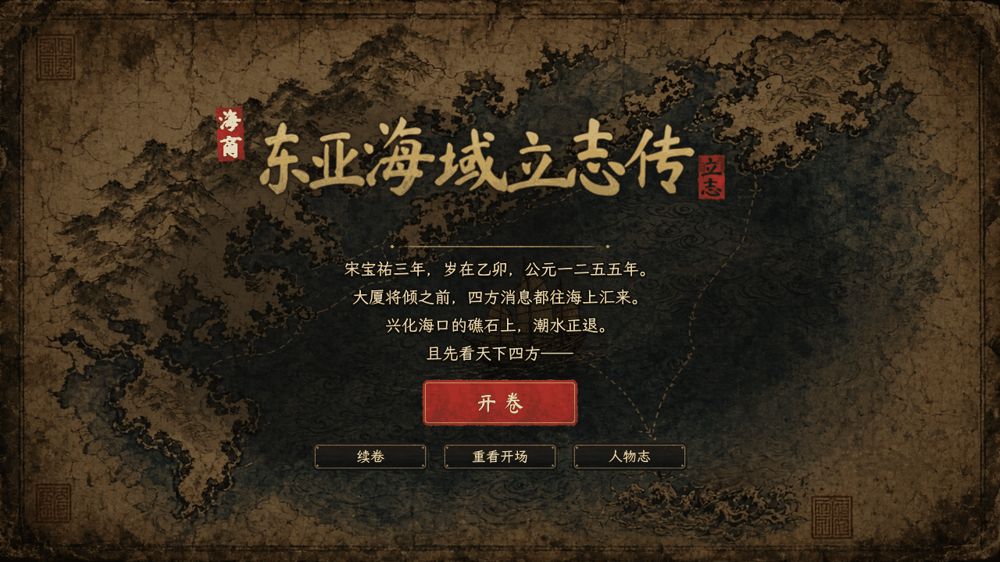
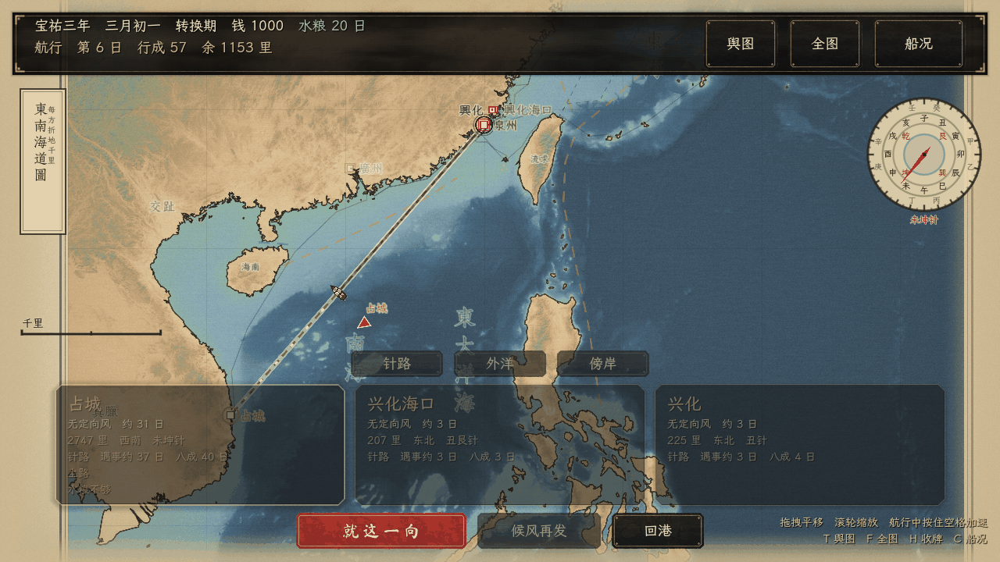
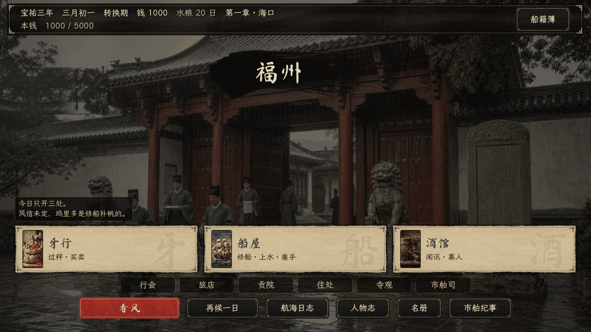
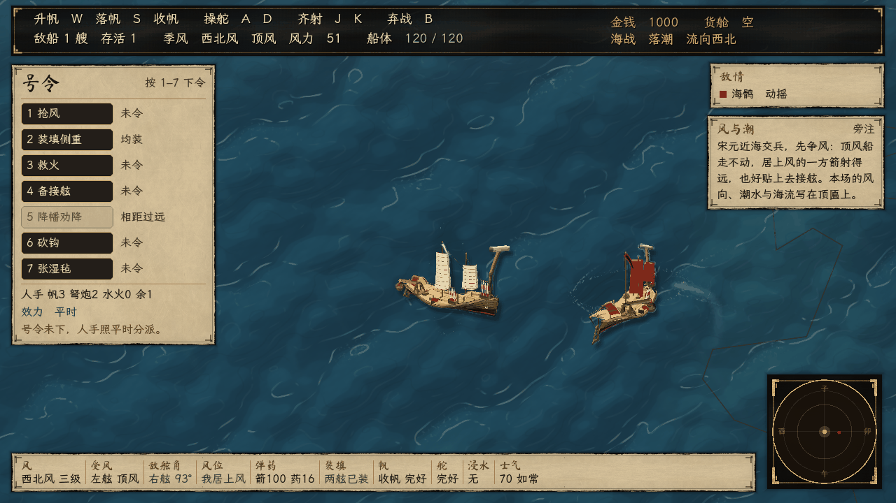

# East Asian Seas: A Merchant's Ambition (nk1)

[简体中文](README.md) | **English** | [日本語](README.ja.md)

A historical maritime trading and strategy game set in the East Asian seas at the end of the Southern Song dynasty, built with Godot 4.6.

It is 1255, the third year of Baoyou, at the harbor mouth of Xinghua. You play Chen Zilong, a young scholar from Yuhu in Putian, starting out with a single small coastal junk. You trade between Quanzhou, Mingzhou, Hakata, Tamna (Jeju), Champa and other ports, take on brokers' contracts, and deal with pirates and customs seizures. Two decades later the Mongol Yuan armies push south, and a merchant's ledger becomes tangled up with the fate of a dynasty.

> The in-game text is currently Chinese only. The project is under active development and has no official release yet.

<p>
  
  
  
  
</p>

<sub>Captured from the running game at 1280×720 by `tools/patrol_shell.gd` and `tools/qa_chart_hud_screenshots.gd`.</sub>

## The game

- **Period and characters**: The story runs from 1255, the third year of Baoyou, to 1279, the second year of Xiangxing, and the Battle of Yamen. `data/characters.json` holds 75 characters, 41 of them historical figures such as Wen Tianxiang, Zhang Shijie, Lu Xiufu, Pu Shougeng, Jia Sidao, Bayan, Kublai Khan and Hōjō Tokiyori. Notes checking dates against the sources live in `docs/`.
- **Historical scope**: The game runs from 1255 to 1279. China is confined to the Song, Jin and Yuan; Japan is in the Kamakura period, Tamna belongs to Goryeo, Champa is in its Hindu-Cham period, and the Ryukyu port is Gusuku-era. Mingzhou appears under its official name Qingyuan Prefecture, paper money is huizi and guanzi, and architecture, dress and ships avoid Ming–Qing forms. The Jin capital, burned in 1215, is a ruin under Mongol rule.
- **Ports and sea chart**: 14 ports, from Xinghua, Quanzhou, Fuzhou, Wenzhou and Penghu to Mingzhou, Tamna, the Chinese quarter of Hakata, Guangzhou, Satsuma and Champa, opening up chapter by chapter. The chart is drawn from real coordinates and Natural Earth coastlines, distances follow the sea lanes, and the monsoon decides when you can sail.
- **City districts**: Five ports — Quanzhou, Xinghua, Guangzhou, Wenzhou and the Chinese quarter of Hakata — have a City Districts entry on the port page. Inside are 71 places and 281 dealings: buying and selling, putting money into shops, hiring, sounding out the market, taking out passes and working the season, each with its own background.
- **Economy**: 29 goods (rice, raw silk, qingbai porcelain, incense and medicines, Japanese copper, Japanese swords…) each have producing and consuming ports. Price gaps, market depth, flooding a market, contraband, maritime-customs levies, brokers' contracts and wartime prices all affect your profit. There are also 8 ship types, crew and supplies, harbor investment and five ranks of standing with the customs office.
- **Seasons and broker credit**: Nine goods — rice, tea, raw silk, silk cloth, sea salt, sable fur, deer hide, Japanese fans and sutra scrolls — rise and fall with the month (rice is dearest in the fourth month and cheapest after the autumn harvest). Cargo can be sold to the local broker on credit at a locked price, settled two months later; default depends on mercantile credit and the war.
- **Shipyard refits**: The yard holds one ship at a time. Sail, armor and caulking each have three grades and can be raised step by step. Sail adds daily speed, armor cuts hull damage, and caulking cuts storm and shoal damage as well as water damage to fragile cargo.
- **Taverns and ports**: Taverns are where you hear rumors, hire crew and meet people. Ports also have the customs office, brokers' guild, shipyard, inn, merchant guild, academy, temples and more.
- **Notes for new players**: In a fresh game, the first visit to a port, a broker, the sea chart, a pirate encounter, the customs office and the first completed voyage each bring a small note at the page edge. Six in all; once read, they do not return.
- **Combat**: Real-time naval battles where you handle the ship yourself (wind, broadsides, ammunition, flooding and fire, boarding and hand-to-hand fighting, morale), plus shore raids, city sieges and defenses, and the Battle of Yamen. The design is in [docs/combat_realism_design.md](docs/combat_realism_design.md) (Chinese).
- **Story**: Four main chapters (Harbor Mouth / Old Debts / Fleet Master / Southern Seas). 105 story scenes act as chapter gates, with free-form trading in between, and the endgame has four endings.
- **Saves and cutscenes**: Three save slots (a damaged save falls back to its `.bak` copy). The opening, chapter transitions and endings have subtitled cinematic cutscenes.
- **Art**: All 75 characters in the codex have portraits (74 paintings, one silhouette still to be painted), alongside 29 goods icons, 8 ship plates and 71 district backgrounds. The interface is in a silk-and-ink style.

## Current status

- The four chapters, economy, sailing, naval combat, sieges and endings can all be played from start to finish. `tools/simulate_run.py` plays a full run automatically to catch dead ends.
- City districts are open for five ports — Quanzhou, Xinghua, Guangzhou, Wenzhou and the Chinese quarter of Hakata; the other ports' districts are still being painted and are not in the game yet.
- The companion system has a roster and portraits, but it is not yet part of play; its design is still being decided.
- Development is driven by design documents and automated checks. The history starts in June 2026 and has nearly 1,700 commits.

## Running the game

You need [Godot 4.6](https://godotengine.org/) (the standard build is fine; the project is pure GDScript with no third-party plugins).

1. Clone this repository.
2. Open `project.godot` in Godot 4.6 and press F5 (the main scene is `scenes/Main.tscn`).

Or from the command line:

```bash
godot --path .
```

On Linux machines without a GPU, use the compatibility renderer: `godot --path . --rendering-method gl_compatibility` (`.cursor/run-game.sh` is an example launcher for a GPU-less VM). If you get a black screen or grey placeholder textures, the `.godot/` import cache probably doesn't match your Godot version: delete `.godot/` and rebuild it with `godot --headless --import --path .`.

Naval combat keys: **W/S** sail setting, **A/D** helm, **J/K** fire port/starboard, **G** board, **B/Esc** break off.

## Automated checks

A change is done when all 36 required gates pass. [docs/GATES.md](docs/GATES.md) explains what each gate checks and what a failure looks like, and [docs/开发笔记.md](docs/开发笔记.md) has the full command list (both in Chinese).

The Python checks don't need Godot (Python 3, standard library only):

```bash
python3 tools/check_symbols.py      # cross-file symbols, autoload order, text style rules, feature contracts
python3 tools/verify_economy.py     # data integrity, arbitrage, market flooding, monsoon, contracts
python3 tools/simulate_run.py       # plays a full run end to end, looking for dead ends and overflows
python3 tools/verify_story_data.py  # story effect keys and save fields
python3 tools/check_probe_registry.py  # every probe is registered
```

Godot checks (import the assets once first):

```bash
godot --headless --import --path .
godot --headless --path . -s res://tools/godot_smoke.gd          # smoke test, ends with GODOT SMOKE PASS
godot --headless --path . -s res://tools/godot_compile_check.gd  # every script compiles
godot --headless --path . -s res://tools/godot_story_check.gd    # main story line and save round-trip
```

`tools/` also contains more than 180 `qa_*_probe.gd` runtime probes covering the sea chart, economy panels, saves, cutscenes, combat, keyboard focus, audio and more. Each one runs the same way: `godot --headless --path . -s res://tools/<probe>.gd`.

## Repository layout

```
data/      JSON data: ports, goods, ships, characters, chapters, story scenes, cutscenes, endings
scenes/    scenes (main, sea chart, combat, cutscenes, UI)
scripts/   GDScript; core/ holds the autoload singletons (Calendar, Economy, Fleet, Crew, Voyage, SaveLoad)
assets/    art, fonts, shaders, ship meshes, chart base maps
tools/     Python static checks, Godot smoke tests and runtime probes, art and ship pipelines
docs/      design docs, historical research, audit notes and gate docs (index: docs/README.md)
```

## Contributing

See [CONTRIBUTING.md](CONTRIBUTING.md) for details.

Issues and pull requests are welcome, especially on historical accuracy, writing, balance and bugs.

- Run the checks above before submitting; at minimum run the gates for the area you changed (see [docs/GATES.md](docs/GATES.md)).
- When you add scripts or assets, commit the `.uid` / `.import` files Godot generates alongside them (`tools/check_sidecars.py` checks this).
- When you add a document under `docs/`, add a line for it in [docs/README.md](docs/README.md).
- The economy balance is delicate; the reasoning behind the numbers is in [docs/复刻设计_大航海时代标准.md](docs/复刻设计_大航海时代标准.md).

## License

The source code is released under the [MIT License](LICENSE) (Copyright (c) 2026 haru225-coder). Art, music and other assets in `assets/` are not covered by the MIT License; all rights are reserved unless stated otherwise. See [ASSETS.md](ASSETS.md).
